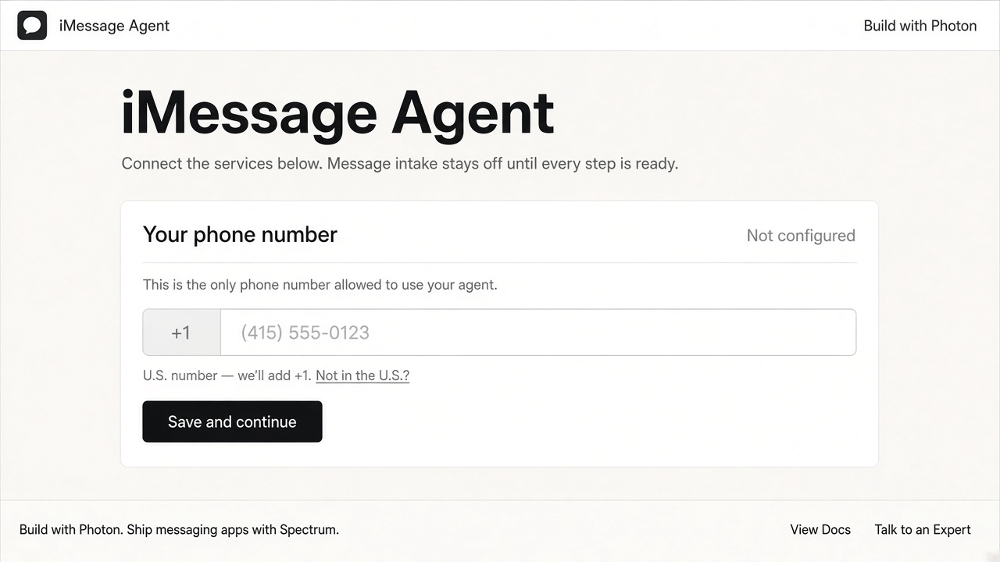
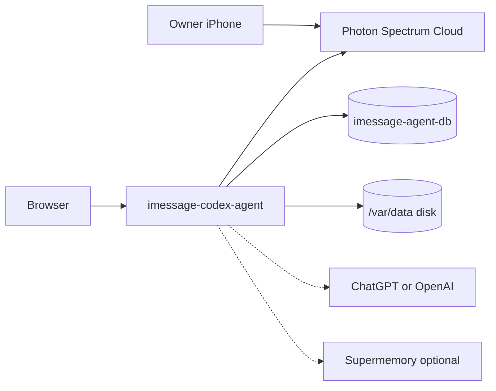

<div align="center">

# iMessage Codex Agent on Render

Deploy a private iMessage agent on Render. Photon Spectrum carries the messages, Codex does the work, PostgreSQL keeps the queue, and a persistent disk holds credentials.

<p>
  <a href="https://render.com/deploy-template/api/github/start?template_repo=imessage-codex-agent-render-template">
    
  </a>
</p>

<p>
  <a href="https://render.com">
    
  </a>
  <a href="https://github.com/photon-hq/render-imessage-template">
    
  </a>
  <a href="https://photon.codes">
    
  </a>
  <a href="https://docs.photon.codes">
    
  </a>
</p>

</div>



## What This Template Shows

This repo packages [photon-hq/render-imessage-template](https://github.com/photon-hq/render-imessage-template) as a one-click Render gallery template. The public URL is the setup dashboard. You talk to the agent in iMessage, not in the browser.

| Piece | Role |
| --- | --- |
| **[Photon iMessage template](https://github.com/photon-hq/render-imessage-template)** | Express runtime: owner dashboard, pg-boss queue, Codex child processes |
| **[Photon Spectrum](https://photon.codes)** | Cloud iMessage line and the persistent `app.messages` stream |
| **[Render Web Service](https://render.com/docs/web-services)** | Native Node 22.12 process, health check `/healthz` |
| **[Render PostgreSQL](https://render.com/docs/postgresql)** | Operational source of truth and durable queue |
| **[Render Disk](https://render.com/docs/disks)** | Codex credentials at `/var/data/codex`, workspaces at `/var/data/workspaces` |

Render has no iMessage primitive. Spectrum Cloud is the channel. ChatGPT / OpenAI and optional [Supermemory](https://supermemory.ai) are configured after deploy.

## Architecture



### How It Works

1. Click **Deploy to Render**. Render forks this template into your GitHub account and applies [`render.yaml`](./render.yaml).
2. Render builds with `npm ci --include=dev && npm run build`, migrates Postgres, mounts 1 GB at `/var/data`, and starts `npm start` on `$PORT`.
3. Open the `*.onrender.com` URL. Save your personal phone number, authenticate Photon, then connect ChatGPT. No Blueprint secrets are prompted at Apply.
4. `/healthz` is already 200. `/readyz` becomes 200 when owner identity, storage, Postgres, queue, Codex, and Spectrum are ready.
5. Text the Photon-assigned number from the saved owner phone. Unauthorized senders are rejected before any model work.

| Resource | Type | Plan | Notes |
| --- | --- | --- | --- |
| `imessage-codex-agent` | Web (`runtime: node`) | **starter** | One instance. Health check `/healthz`. Auto-deploy off. |
| `codex-data` | Disk (1 GB) | 1 GB | Mounted at `/var/data`. Blocks horizontal scaling. |
| `imessage-agent-db` | PostgreSQL 18 | **basic-256mb** | 15 GB storage. Internal URL only (`ipAllowList: []`). |

Default region: **oregon**. The disk makes this stack single-instance: do not raise `numInstances` without redesigning credential and workspace ownership.

## Quick Start

### Prerequisites

- A [Render account](https://dashboard.render.com/register?utm_source=github&utm_medium=referral&utm_campaign=ojus_demos&utm_content=readme_link)
- A [Photon](https://app.photon.codes) account for Spectrum Cloud iMessage
- The owner's personal phone number
- A ChatGPT account with device login, or an OpenAI API key

### Deploy

1. Click **Deploy to Render** above and fork into your GitHub account.

   <p>
     <a href="https://render.com/deploy-template/api/github/start?template_repo=imessage-codex-agent-render-template">
       
     </a>
   </p>
2. On Apply, confirm the web service, disk, and Postgres database. There are no `sync: false` prompts.
3. Wait until the web service is **Live** (~5–10 minutes).
4. Open the public URL. Save the owner phone, finish Photon setup, then connect ChatGPT.
5. Confirm `/readyz` returns 200, then iMessage the assigned number from the owner phone.

```bash
curl --fail --silent "https://<your-service>.onrender.com/healthz"
curl --silent --show-error "https://<your-service>.onrender.com/readyz"
```

A fresh deploy is expected to return `/healthz` 200 and `/readyz` 503 until dashboard setup finishes.

## Features

| Feature | Description |
| --- | --- |
| **Dashboard onboarding** | Owner phone, Photon, and ChatGPT are configured in the browser after deploy |
| **Owner-only iMessage** | One E.164 identity is authorized; unknown senders never reach Codex |
| **Durable queue** | pg-boss in Postgres; inbound work is not handled inline on the Spectrum stream |
| **Codex on disk** | ChatGPT device credentials persist under `/var/data/codex` |
| **Generated encryption key** | `APP_ENCRYPTION_KEY` is created at provision time |
| **Optional memory** | Set `SUPERMEMORY_API_KEY` later; Postgres stays the source of truth |

## Configuration

The Blueprint prompts for nothing at Apply. Owner phone, Photon project credentials, and ChatGPT login are stored by the dashboard.

| Variable | Source | Description |
| --- | --- | --- |
| `NODE_VERSION` | Blueprint | `22.12.0` |
| `NODE_ENV` | Blueprint | `production` |
| `DATABASE_URL` | Wired | Internal connection string from `imessage-agent-db` |
| `CODEX_HOME` | Blueprint | `/var/data/codex` |
| `AGENT_WORKSPACE_ROOT` | Blueprint | `/var/data/workspaces` |
| `CODEX_AUTH_MODE` | Blueprint | `chatgpt` (switch to `api_key` after deploy if needed) |
| `APP_ENCRYPTION_KEY` | Auto-generated | 256-bit key used to encrypt owner identity at rest |
| `PORT` | Render-injected | HTTP listen port; omit from the Blueprint |
| `OPENAI_API_KEY` | Optional | Required only after you set `CODEX_AUTH_MODE=api_key` |
| `SUPERMEMORY_API_KEY` | Optional | Leave unset to disable semantic memory |

Full reference: [docs/CONFIGURATION.md](./docs/CONFIGURATION.md). API-key mode:

```dotenv
CODEX_AUTH_MODE=api_key
OPENAI_API_KEY=replace-with-a-Render-secret
```

Then manual-deploy the web service. The runtime passes the key only to the Codex child process.

## Cost

Approximate monthly compute from [Render pricing](https://render.com/pricing) (Hobby workspace, Oregon):

| Resource | Approx. monthly |
| --- | ---: |
| Web service (Starter, 512 MB) | $7 |
| Disk (1 GB) | $0.25 |
| PostgreSQL (Basic 256 MB) | $6 |
| Extra Postgres storage (14 GB beyond the included 1 GB) | ~$4.20 |
| **Total** | **~$17–18** |

Photon Spectrum, ChatGPT / OpenAI, and Supermemory are billed by those providers. Starter is the upstream floor. If Codex OOMs at boot (`Reached heap limit` or `No open ports detected`), raise the web plan to **Standard** ($25).

## Troubleshooting

| Problem | Solution |
| --- | --- |
| Health check fails / no open ports | Confirm the process binds `0.0.0.0:$PORT`. If logs show heap exhaustion, move the web service to Standard. |
| `/readyz` stays 503 | Expected until owner, Photon, and Codex setup finish. Read the JSON snapshot; do not treat `/healthz` as acceptance. |
| Pre-deploy migration failed | `npm run db:migrate` could not reach Postgres. Check the database is Live in the same region, then retry the deploy. |
| Setup action returns 403 | Open the dashboard from the service origin in a trusted browser. Cross-site fetch is rejected on purpose. |
| Codex auth missing | Finish ChatGPT device login in the dashboard, or set `CODEX_AUTH_MODE=api_key` plus `OPENAI_API_KEY` and redeploy. |

More cases: [docs/TROUBLESHOOTING.md](./docs/TROUBLESHOOTING.md).

## Project Structure

```
render.yaml                 Render Blueprint (web + Postgres + disk)
README.md                   This file
README.UPSTREAM.md          Upstream operator README
LICENSE                     MIT
.env.example                Local env template
.nvmrc                      Node 22.12.0
assets/                     Hero / logo
src/server.ts               Production HTTP entrypoint
src/runtime/production-bootstrap.ts
prompts/                    Personality, execution, and approval policy
docs/                       Deployment, config, operations
```

## Learn More

**Render:**
- [Web Services](https://render.com/docs/web-services)
- [PostgreSQL](https://render.com/docs/postgresql)
- [Disks](https://render.com/docs/disks)
- [Blueprints](https://render.com/docs/infrastructure-as-code)

**Upstream:**
- [photon-hq/render-imessage-template](https://github.com/photon-hq/render-imessage-template)
- [Deployment guide](./docs/DEPLOYMENT.md)
- [Architecture](./docs/ARCHITECTURE.md)
- [Photon Spectrum docs](https://docs.photon.codes)
- [spectrum-ts](https://github.com/photon-hq/spectrum-ts)

## License

[MIT](LICENSE) for this template and the upstream agent (Copyright (c) 2026 Photon AI).
